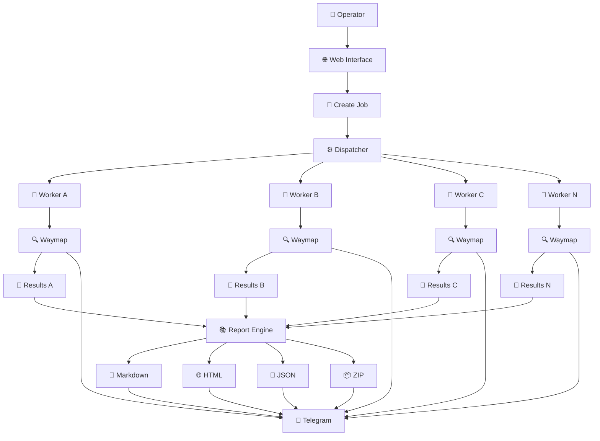
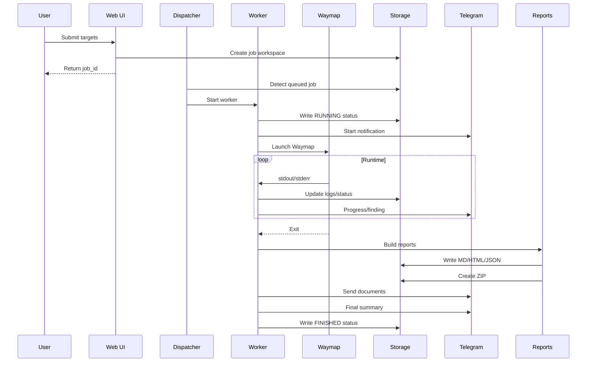

<div align="center">

# 🧭 Waymap Scanner Platform

### ⚡ Automated Web Security Assessment • Multi-Worker • Real-Time Monitoring • Telegram Reporting

<p>
  
  
  
  
  
</p>

<p>
  <strong>Waymap Scanner Platform</strong> is a server-side orchestration layer around
  <a href="https://github.com/TrixSec/waymap">Waymap</a> designed to turn a manual
  security-scanning workflow into a repeatable, observable, report-oriented pipeline.
</p>

> 🛡️ **Authorized use only.** Run automated security testing only against systems you own,
> manage, or have explicit permission to assess. Respect the target's scope, rules, rate limits,
> and applicable laws.

</div>

---

## ✨ What Is Waymap Scanner Platform?

Waymap Scanner Platform is not intended to replace Waymap itself.

Instead, it acts as a **control and orchestration layer** around the scanner so that the operator can:

- 🌐 submit targets from a web interface;
- 🧩 create an isolated job for every submission;
- ⚙️ launch independent background workers;
- 🔍 execute Waymap without keeping a browser request open;
- 📡 observe progress while the scanner is still running;
- 🚨 surface findings as they appear;
- 📱 push operational updates to Telegram;
- 📄 generate structured Markdown/HTML/JSON reports;
- 📦 package the complete report set into an archive;
- 🔎 diagnose a failed worker from persistent job logs;
- ♾️ run multiple jobs concurrently when server resources allow it.

The central design idea is simple:

```text
                 CONTROL PLANE
        ┌─────────────────────────────┐
        │ Browser / Web Interface      │
        │ Job creation / Monitoring    │
        └──────────────┬──────────────┘
                       │
                       ▼
                 ORCHESTRATION
        ┌─────────────────────────────┐
        │ Dispatcher                  │
        │ Job isolation               │
        │ Process lifecycle           │
        └──────────────┬──────────────┘
                       │
            ┌──────────┼──────────┐
            ▼          ▼          ▼
        Worker A    Worker B    Worker C
            │          │          │
            ▼          ▼          ▼
         Waymap     Waymap     Waymap
            │          │          │
            └──────────┼──────────┘
                       ▼
              Results / Reports
                       │
              ┌────────┴────────┐
              ▼                 ▼
         Web Dashboard      Telegram
```

This separation is what makes the platform useful for long-running scans.

---

# 📚 Table of Contents

- [✨ What Is Waymap Scanner Platform?](#-what-is-waymap-scanner-platform)
- [🎯 Project Goals](#-project-goals)
- [🧠 Design Principles](#-design-principles)
- [🧱 Architecture](#-architecture)
- [🔄 End-to-End Pipeline](#-end-to-end-pipeline)
- [🛰️ Pipeline in Detail](#️-pipeline-in-detail)
- [📁 Project Structure](#-project-structure)
- [🪪 Job Lifecycle](#-job-lifecycle)
- [⚙️ Dispatcher](#️-dispatcher)
- [👷 Worker System](#-worker-system)
- [🔍 Waymap Engine](#-waymap-engine)
- [📡 Live Output](#-live-output)
- [🚨 Finding Pipeline](#-finding-pipeline)
- [📲 Telegram Integration](#-telegram-integration)
- [📄 Reporting System](#-reporting-system)
- [📦 Report Archive](#-report-archive)
- [♾️ Concurrent Jobs](#️-concurrent-jobs)
- [🗃️ Job Workspace](#️-job-workspace)
- [📊 Status and Observability](#-status-and-observability)
- [🔧 Configuration](#-configuration)
- [🚀 Installation](#-installation)
- [▶️ Running the Platform](#️-running-the-platform)
- [🧪 Testing and Self-Checks](#-testing-and-self-checks)
- [🩺 Troubleshooting](#-troubleshooting)
- [🔐 Security Hardening](#-security-hardening)
- [⚡ Performance and Resource Planning](#-performance-and-resource-planning)
- [🤖 Optional AI Layer](#-optional-ai-layer)
- [📐 Technical Data Flow](#-technical-data-flow)
- [🧩 Failure Handling](#-failure-handling)
- [🛠️ Development Guidelines](#️-development-guidelines)
- [🗺️ Roadmap](#️-roadmap)
- [📚 References](#-references)
- [⚠️ Disclaimer](#️-disclaimer)

---

# 🎯 Project Goals

The platform is designed around six operational goals:

### 1. 🌐 Simplify target submission

The operator should not need to prepare shell commands manually for every scan.

### 2. ⚙️ Separate the browser from the scanner

The web request creates the job. The worker performs the long-running work in the background.

### 3. 📡 Make long scans observable

A long-running scan should not feel like a black box.

Operators need to know:

- whether the worker started;
- whether Waymap started;
- what phase is running;
- how long the job has been active;
- how many findings have been observed;
- whether errors occurred;
- what the most recent output was.

### 4. 📱 Make Telegram useful as an operational console

Telegram is treated as a notification channel for:

- scan started;
- progress;
- milestone;
- finding;
- module error;
- report availability;
- final completion.

### 5. 📄 Preserve evidence in durable files

Telegram is excellent for notifications, but persistent report files remain the source of truth for the completed assessment.

### 6. ♾️ Support independent jobs

A running job should not automatically block an unrelated job.

A multi-worker architecture allows:

```text
Job #1 ─────────────── RUNNING
Job #2 ─────────────── RUNNING
Job #3 ─────────────── RUNNING
Job #4 ─────────────── RUNNING
```

subject to actual host resources and operating-system limits.

---

# 🧠 Design Principles

## 🔹 Principle 01 — One Job, One Workspace

Every scan receives a unique ID.

```text
job-001/
job-002/
job-003/
```

No two workers should share:

- `targets.txt`
- `worker.log`
- `results.jsonl`
- `status.json`
- report files
- temporary state

This prevents cross-job contamination.

---

## 🔹 Principle 02 — One Job, One Worker

Conceptually:

```text
Job A → Worker A
Job B → Worker B
Job C → Worker C
```

This is the foundation for concurrent execution.

---

## 🔹 Principle 03 — The Browser Is Not the Worker

The browser should only:

```text
POST → create job → receive job_id
```

The scan itself should continue independently.

---

## 🔹 Principle 04 — Persistent State Beats In-Memory State

If the page refreshes, the job should still be visible.

If the browser closes, the job should still have a persistent workspace.

The important state is therefore written to disk.

---

## 🔹 Principle 05 — Notifications Must Not Define Scan State

Telegram is a delivery channel.

It should never be the only source of truth.

Even if Telegram is temporarily unavailable:

```text
Waymap scan
    ↓
worker logs
    ↓
results
    ↓
reports
```

should continue whenever possible.

---

## 🔹 Principle 06 — Errors Must Be Observable

A silent failure is worse than a visible failure.

Every important stage should have:

```text
status
log
exit code
error message
```

whenever practical.

---

# 🧱 Architecture



### Control plane vs execution plane

| Layer | Responsibility |
|---|---|
| 🌐 Web | input, configuration, job creation, status |
| ⚙️ Dispatcher | scheduling and process launch |
| 👷 Worker | lifecycle, logging, Waymap execution, report finalization |
| 🔍 Waymap | actual scanning engine |
| 💾 Job storage | persistent state and artifacts |
| 📡 Telegram | notifications and delivery |
| 📄 Report engine | human-readable outputs |

---

# 🔄 End-to-End Pipeline

The complete workflow can be summarized as:

```text
        TARGET INPUT
             │
             ▼
    ┌─────────────────┐
    │ 1. NORMALIZE    │
    │ clean / validate │
    └────────┬────────┘
             ▼
    ┌─────────────────┐
    │ 2. CREATE JOB   │
    │ unique job_id   │
    └────────┬────────┘
             ▼
    ┌─────────────────┐
    │ 3. DISPATCH     │
    │ background PID  │
    └────────┬────────┘
             ▼
    ┌─────────────────┐
    │ 4. WORKER BOOT  │
    │ env + dirs + log│
    └────────┬────────┘
             ▼
    ┌─────────────────┐
    │ 5. WAYMAP START │
    └────────┬────────┘
             │
     ┌───────┼────────┐
     ▼       ▼        ▼
   Recon   Crawl    Scan Modules
     │       │        │
     └───────┼────────┘
             ▼
       Findings / Logs
             │
      ┌──────┴───────┐
      ▼              ▼
   Telegram        Storage
      │              │
      └──────┬───────┘
             ▼
       REPORT BUILD
             │
    ┌────────┼─────────┐
    ▼        ▼         ▼
   MD      HTML       JSON
    └────────┼─────────┘
             ▼
            ZIP
             │
             ▼
     TELEGRAM DELIVERY
             │
             ▼
       FINAL SUMMARY
```

---

# 🛰️ Pipeline in Detail

## 1️⃣ Target Input

The operator enters one or more targets.

Example:

```text
https://example.com
https://app.example.com
https://api.example.com
```

Input handling should normalize:

- empty lines;
- duplicate targets;
- surrounding whitespace;
- simple formatting noise;
- URL scheme normalization where appropriate.

The platform should not assume that a target is automatically authorized. Authorization remains the operator's responsibility.

---

## 2️⃣ Job Creation

A job receives an identifier such as:

```text
20260929_120501_a81f24c7
```

A good job ID should be:

- unique enough for concurrent requests;
- filesystem-safe;
- easy to search in logs;
- easy to reference in Telegram.

---

## 3️⃣ Dispatcher

The dispatcher is responsible for:

- detecting new jobs;
- identifying which jobs require execution;
- launching workers independently;
- recording worker PID/state;
- maintaining active job visibility.

The dispatcher should **not** perform the entire scan itself.

Its job is orchestration.

---

## 4️⃣ Worker Boot

When a worker starts, it should establish:

```text
job directory
targets
status file
worker log
command metadata
runtime metadata
Telegram context
Waymap environment
```

Only then should it launch the scanner.

This creates a useful invariant:

> If a job says RUNNING, there should be persistent evidence explaining what process is running and where its logs are stored.

---

## 5️⃣ Waymap Execution

Waymap is the scanning engine.

The platform can invoke the native Waymap CLI with options appropriate to the configured assessment.

Waymap supports target selection, scan selection, crawl depth, thread control, reporting, and several scan modules.

Example:

```bash
python waymap.py \
  --target https://example.com \
  --scan all \
  --crawl 2 \
  --threads 4 \
  --no-prompt
```

The exact command should always reflect the version installed on the server.

---

# 🔍 Waymap Engine

Waymap's source repository is:

> https://github.com/TrixSec/waymap

The platform treats Waymap as an external engine and focuses on process orchestration around it.

Typical scan categories available in the Waymap CLI include areas such as:

```text
SQL Injection
Command Injection
SSTI
XSS
LFI
Open Redirect
CRLF
CORS
API
Misconfiguration
Redirect
Advanced Injection
GraphQL
Authentication Logic
Cache/Smuggling
WordPress Extras
Optional modules
```

The exact available modules depend on the installed Waymap version.

---

# 📡 Live Output

A long scan should not require repeatedly refreshing a browser and guessing whether anything is happening.

The live pipeline is:

```text
Waymap stdout/stderr
        │
        ▼
     worker
        │
        ├──────► worker.log
        │
        ├──────► status.json
        │
        └──────► Telegram notifier
```

## What can be monitored?

Typical telemetry includes:

- current phase;
- elapsed time;
- worker PID;
- scanner PID;
- number of targets;
- number of findings;
- severity counters;
- last output line;
- latest scanner statistics;
- report generation phase;
- document delivery status.

---

## 📡 Example Live Message

```text
🧭 WAYMAP LIVE

Job: 20260929_120501_a81f24c7
State: RUNNING
Phase: COMPREHENSIVE SCAN
Target: https://example.com
Runtime: 00:04:17
Findings: 6

Latest output:
[•] Scanning SQL Injection
[•] XSS checks in progress
[•] CORS checks completed
```

The actual output depends on what Waymap emits.

---

# 🚨 Finding Pipeline

A finding should pass through several conceptual stages:

```text
Scanner detects issue
        ↓
Worker parses result
        ↓
Finding normalized
        ↓
Finding persisted
        ↓
Finding count updated
        ↓
Telegram notification
        ↓
Final report renderer
```

A normalized finding may contain information such as:

```json
{
  "type": "SQL Injection",
  "severity": "High",
  "url": "https://example.com/item?id=1",
  "parameter": "id",
  "payload": "<scanner-generated-payload>",
  "details": "Evidence returned by scanner",
  "source": "Waymap"
}
```

The exact schema depends on the Waymap result format.

---

# 📲 Telegram Integration

Telegram is used as an operational alert channel.

## Message categories

### 🟢 Start

```text
🟢 WAYMAP STARTED

Job: 20260929_120501_a81f24c7
Targets: 3
Mode: all
```

### 🔵 Progress

```text
🔵 WAYMAP PROGRESS

Phase: crawl
Runtime: 00:02:31
Findings: 2
Last output: ...
```

### 🚨 Finding

```text
🚨 WAYMAP FINDING

Severity: HIGH
Type: SQL Injection
Endpoint: ...
Parameter: ...
Evidence: ...
```

### ⚠️ Module Error

```text
⚠️ WAYMAP MODULE ERROR

Module: Misconfiguration
Error: ...
Job: ...
```

### ✅ Finished

```text
✅ WAYMAP FINISHED

Job: ...
Targets: 3
Findings: 8
Duration: 00:11:32

Reports:
✓ report.md
✓ findings.md
✓ final-summary.md
✓ summary.json
✓ index.html
✓ archive.zip
```

---

# 🧯 Telegram Rate Limiting

Telegram has rate limits.

A naïve implementation can accidentally do:

```text
sendMessage
sendMessage
sendMessage
sendMessage
sendMessage
...
```

which can trigger:

```text
HTTP 429 Too Many Requests
```

A robust notifier therefore needs:

```text
Global request gate
       ↓
Queue / batch
       ↓
Retry-After handling
       ↓
Backoff
       ↓
Delivery result
```

## Recommended strategy

### Live progress

Maintain one progress message where possible:

```text
sendMessage()
      ↓
message_id
      ↓
editMessageText()
```

This avoids sending a new message every second.

### Findings

Findings can be sent individually or in controlled batches depending on volume.

### Documents

Documents should be sent sequentially and should also respect the same Telegram delivery policy.

---

# 📄 Reporting System

The final reporting stage should transform scanner data into human-readable documents.

A recommended report set is:

```text
report.md
findings.md
final-summary.md
summary.json
index.html
```

---

## 📝 `report.md`

General technical report.

Typical sections:

```text
Executive Summary
Assessment Metadata
Targets
Scan Configuration
Severity Summary
Module Summary
Detailed Findings
Errors / Warnings
Recommendations
References
```

---

## 🔎 `findings.md`

A compact, searchable findings document.

Example:

```text
# Findings

## [HIGH] SQL Injection
Target: ...
Parameter: ...

## [MEDIUM] Missing Security Header
Target: ...
Header: ...
```

---

## 🧾 `final-summary.md`

The final completion document.

Useful fields:

```text
Job
Start Time
End Time
Duration
Targets
Modules
Total Findings
Critical
High
Medium
Low
Info
Errors
Warnings
Report Files
Telegram Delivery Status
```

---

## 🧩 `summary.json`

Machine-readable summary.

Example:

```json
{
  "job_id": "20260929_120501_a81f24c7",
  "state": "finished",
  "targets": 3,
  "findings": 8,
  "severity_counts": {
    "critical": 0,
    "high": 2,
    "medium": 4,
    "low": 1,
    "info": 1
  }
}
```

---

## 🌐 `index.html`

A browser-readable dashboard/report index.

It can expose:

- job metadata;
- severity counts;
- targets;
- findings;
- report links;
- logs;
- delivery status.

---

# 📦 Report Archive

The final archive should be created **after** all individual report files exist.

Correct order:

```text
Waymap complete
      ↓
build report.md
      ↓
build findings.md
      ↓
build final-summary.md
      ↓
build summary.json
      ↓
build index.html
      ↓
create ZIP
      ↓
verify ZIP
      ↓
send documents
      ↓
send final summary
```

A common mistake is creating the ZIP too early.

---

# ♾️ Concurrent Jobs

A major goal of this platform is independent job execution.

For example:

```text
                ┌───────────────┐
                │  Dispatcher   │
                └───────┬───────┘
                        │
       ┌────────────────┼────────────────┐
       ▼                ▼                ▼
   Worker A          Worker B          Worker C
       │                │                │
       ▼                ▼                ▼
    Waymap A         Waymap B         Waymap C
       │                │                │
       ▼                ▼                ▼
    report A         report B         report C
```

## Important distinction

There are two kinds of concurrency:

### Job-level concurrency

Multiple independent jobs:

```text
Job A ───────── RUNNING
Job B ───────── RUNNING
Job C ───────── RUNNING
```

### Scanner-level concurrency

Inside one Waymap process:

```text
Waymap
 ├── thread 1
 ├── thread 2
 ├── thread 3
 └── thread 4
```

These are different controls.

Increasing both at the same time multiplies resource usage.

---

# 🗃️ Job Workspace

A recommended workspace:

```text
/var/lib/waymap-scanner/jobs/
└── 20260929_120501_a81f24c7/
    ├── input.txt
    ├── targets.txt
    ├── command.txt
    ├── status.json
    ├── worker.log
    ├── dispatcher.log
    ├── results.jsonl
    ├── telegram.log
    ├── findings.jsonl
    └── reports/
        ├── report.md
        ├── findings.md
        ├── final-summary.md
        ├── summary.json
        ├── index.html
        ├── findings/
        │   ├── 0001.md
        │   ├── 0002.md
        │   └── ...
        └── waymap-documents-<JOB_ID>.zip
```

This layout makes debugging far easier than storing everything in one global directory.

---

# 📊 Status and Observability

A good `status.json` is more than a boolean.

Example:

```json
{
  "job_id": "20260929_120501_a81f24c7",
  "state": "running",
  "phase": "scan",
  "target_count": 3,
  "findings": 6,
  "severity_counts": {
    "critical": 0,
    "high": 2,
    "medium": 3,
    "low": 1,
    "info": 0
  },
  "worker_pid": 31120,
  "scanner_pid": 31124,
  "runtime_seconds": 257,
  "last_output": "[•] Scanning ...",
  "updated_at": "..."
}
```

This allows the web dashboard to answer:

> Is this job actually alive?

rather than only:

> Was this job created?

---

# 🔧 Configuration

Configuration should be centralized.

Common areas:

```text
Waymap binary
Python interpreter
Job root
Report root
Telegram token
Telegram chat ID
Telegram rate policy
Waymap thread count
Waymap crawl depth
scan modules
severity filters
logging
concurrency
```

A production deployment should keep credentials outside public source control.

---

## Telegram Configuration

Conceptually:

```json
{
  "enabled": true,
  "bot_token": "REPLACE_WITH_NEW_BOT_TOKEN",
  "chat_id": "REPLACE_WITH_CHAT_ID"
}
```

Do **not** publish real bot tokens in GitHub.

---

## Concurrency Configuration

Example concept:

```text
WAYMAP_MAX_CONCURRENT_JOBS=8
```

This is a scheduler policy.

It should not be confused with Waymap's internal:

```text
--threads 4
```

---

# 🚀 Installation

## Requirements

Typical server requirements:

- Linux server/VPS;
- PHP;
- PHP CLI;
- Python 3;
- Waymap dependencies;
- Waymap source;
- systemd (recommended for stable deployment);
- outbound HTTPS access;
- writable job storage.

---

## 1. Install Waymap

Refer to the official repository:

> https://github.com/TrixSec/waymap

Typical setup:

```bash
git clone https://github.com/TrixSec/waymap.git /opt/waymap
cd /opt/waymap
python3 -m venv venv
source venv/bin/activate
pip install -r requirements.txt
```

Use the installation method recommended by the exact Waymap version you deploy.

---

## 2. Verify Waymap

```bash
/opt/waymap/venv/bin/python /opt/waymap/waymap.py --version
```

If your checked-out version stores the entrypoint elsewhere, use that path instead.

---

## 3. Deploy the Platform

A common project path is:

```text
/var/www/html/scn/
```

Example:

```bash
mkdir -p /var/www/html/scn
```

Copy the platform files into that directory.

---

## 4. Create the Job Storage

```bash
mkdir -p /var/lib/waymap-scanner/jobs
```

Assign ownership appropriate to the user that executes the worker.

---

## 5. Configure Telegram

Set your bot token and destination chat ID in the server-side configuration.

Never expose the token in client-side JavaScript.

---

## 6. Configure systemd

A service can run the dispatcher continuously.

Conceptual service:

```ini
[Unit]
Description=Waymap Scanner Dispatcher
After=network-online.target

[Service]
Type=simple
User=www-data
WorkingDirectory=/var/www/html/scn
ExecStart=/usr/bin/python3 /var/www/html/scn/dispatcher.py
Restart=always
RestartSec=3

[Install]
WantedBy=multi-user.target
```

Exact settings should match your server's PHP/Python user and filesystem permissions.

---

# ▶️ Running the Platform

The intended user flow is:

```text
Open Web UI
     ↓
Enter authorized target(s)
     ↓
Submit
     ↓
Job ID appears
     ↓
Worker starts
     ↓
Waymap starts
     ↓
Live status appears
     ↓
Telegram receives updates
     ↓
Findings accumulate
     ↓
Waymap completes
     ↓
Reports generated
     ↓
ZIP created
     ↓
Documents delivered
     ↓
Final summary
```

---

# 🧪 Testing and Self-Checks

A reliable installation should be tested in layers.

## Layer 1 — Syntax

```bash
php -l index.php
python3 -m py_compile dispatcher.py
python3 -m py_compile worker/worker.py
```

## Layer 2 — Environment

```bash
command -v php
command -v python3
command -v nuclei
```

## Layer 3 — Waymap

```bash
python3 /opt/waymap/waymap.py --version
```

## Layer 4 — Dispatcher

```bash
systemctl status waymap-dispatcher.service --no-pager
```

## Layer 5 — Worker

Create a controlled test job and confirm:

```text
status.json exists
worker.log exists
Waymap process exists
exit code recorded
```

## Layer 6 — Telegram

Confirm:

```text
bot token valid
chat accessible
sendMessage works
editMessageText works if used
sendDocument works
429 retry logic works
```

## Layer 7 — End-to-End

The final test should cover:

```text
Web
 ↓
Job
 ↓
Dispatcher
 ↓
Worker
 ↓
Waymap
 ↓
Finding
 ↓
Report
 ↓
ZIP
 ↓
Telegram
 ↓
Finished
```

---

# 🩺 Troubleshooting

## ❌ `No worker.log output`

Check:

```bash
ls -la /var/lib/waymap-scanner/jobs/<JOB_ID>/
```

Then:

```bash
cat /var/lib/waymap-scanner/jobs/<JOB_ID>/status.json
```

Then:

```bash
cat /var/lib/waymap-scanner/jobs/<JOB_ID>/worker.log
```

If the worker log does not exist, inspect the dispatcher first.

---

## ❌ Job immediately becomes `ERROR`

Inspect:

```text
status.json
worker.log
dispatcher.log
command.txt
```

Look for:

```text
Traceback
NameError
PermissionError
FileNotFoundError
Executable not found
```

A syntax check cannot catch every runtime error, so end-to-end testing remains important.

---

## ❌ Telegram returns HTTP 429

Do not simply retry every few seconds forever.

The notifier should:

1. inspect the HTTP response;
2. parse `retry_after` when available;
3. sleep for the required interval;
4. apply controlled backoff;
5. keep unsent work pending;
6. avoid generating unnecessary message bursts.

A single progress message that is edited is usually more efficient than creating a new message every second.

---

## ❌ Telegram works manually but not from the worker

The worker is a separate process.

Check:

- environment variables;
- file permissions;
- service user;
- configuration path;
- DNS/HTTPS access;
- proxy settings;
- systemd environment;
- chat ID;
- bot membership/access.

---

## ❌ Reports exist but were not sent

Check:

```text
reports/
delivery.json
telegram.log
```

A report generation failure and a Telegram delivery failure are different classes of problems.

---

## ❌ One job blocks another

Check:

```text
dispatcher configuration
active worker count
resource usage
stale PID files
global mutexes
shared output paths
```

There should be no accidental global lock around the entire Waymap scan.

Global locks are only appropriate for resources that truly must be serialized, such as some Telegram delivery operations.

---

# 🔐 Security Hardening

## 1. Authenticate the Web UI

A production deployment should not expose a powerful scanner dashboard without access control.

Possible controls:

```text
login
session authentication
CSRF protection
role-based access
API key
IP restriction
VPN/private network
```

---

## 2. Protect Job Storage

Do not expose:

```text
/var/lib/waymap-scanner/jobs/
```

as a directly downloadable public directory.

Reports can contain:

- URLs;
- technical evidence;
- scanner output;
- internal metadata;
- test artifacts.

---

## 3. Protect Secrets

Store:

```text
Telegram bot token
AI API key
other credentials
```

outside Git.

A secret should never be hardcoded into:

```text
client-side JavaScript
public README
public Git repository
HTML source
```

---

## 4. Scope Awareness

Automated scanners can generate many requests.

Always verify:

```text
target authorization
allowed paths
allowed hostnames
rate limits
testing windows
third-party restrictions
```

---

## 5. Resource Isolation

For shared servers, consider:

```text
systemd resource limits
CPUQuota
MemoryMax
TasksMax
ulimits
separate service users
```

---

# ⚡ Performance and Resource Planning

Concurrency is powerful but expensive.

Imagine:

```text
8 active jobs
×
Waymap threads = 4
```

That is not simply “8 tasks”.

You may have:

```text
multiple scanner processes
+
multiple internal threads
+
HTTP connections
+
DNS activity
+
filesystem activity
+
report processing
```

Therefore concurrency should be tuned according to:

```text
CPU
RAM
network
number of targets
crawl depth
scanner modules
server bandwidth
```

A practical workflow is:

```text
Start low
  ↓
Observe CPU/RAM
  ↓
Increase concurrent jobs
  ↓
Observe again
  ↓
Tune scanner thread count
```

---

# 🤖 Optional AI Layer

An AI layer can be placed **after** scanner collection rather than inside every network request.

A conceptual pipeline:

```text
Waymap Findings
      ↓
Normalizer
      ↓
Rule-based Deduplication
      ↓
AI Analysis
      ↓
Human-readable Assessment
      ↓
Report
```

AI may help with:

- summarization;
- finding clustering;
- remediation explanation;
- severity rationale;
- duplicate finding reduction;
- executive summaries.

AI output should remain clearly distinguishable from raw scanner evidence.

A robust report therefore separates:

```text
RAW EVIDENCE
SCANNER RESULT
ANALYST INTERPRETATION
AI-ASSISTED SUMMARY
```

This prevents generated language from being mistaken for direct scanner evidence.

---

# 📐 Technical Data Flow



---

# 🧩 Failure Handling

A resilient platform distinguishes between:

## Scanner error

```text
Waymap itself failed
```

## Worker error

```text
worker crashed
```

## Dispatcher error

```text
job was never launched
```

## Report error

```text
scan completed but report generation failed
```

## Telegram error

```text
scan/report completed but notification failed
```

These should not all become the same status.

A useful final state model is:

```text
COMPLETED
COMPLETED_WITH_ERRORS
REPORT_FAILED
TELEGRAM_PARTIAL
FAILED
```

This gives the operator a much clearer picture of what actually happened.

---

# 🧭 Recommended State Machine

```text
                 ┌──────────────┐
                 │   CREATED    │
                 └──────┬───────┘
                        ▼
                 ┌──────────────┐
                 │   STARTING   │
                 └──────┬───────┘
                        ▼
                 ┌──────────────┐
                 │    RUNNING   │
                 └───┬─────┬────┘
                     │     │
          scanner OK │     │ fatal worker/scanner error
                     │     ▼
                     │  ┌────────┐
                     │  │ FAILED │
                     │  └────────┘
                     ▼
              ┌──────────────┐
              │ BUILD REPORT │
              └──────┬───────┘
                     ▼
              ┌──────────────┐
              │ SEND FILES   │
              └──────┬───────┘
                     ▼
              ┌──────────────┐
              │   FINISHED   │
              └──────────────┘
```

Telegram status should be treated as delivery metadata, not as the authoritative job state.

---

# 🛠️ Development Guidelines

When modifying the project, preserve these invariants:

### ✅ Invariant 1

Every job has a unique workspace.

### ✅ Invariant 2

Every worker writes a persistent log.

### ✅ Invariant 3

Every terminal state is written to `status.json`.

### ✅ Invariant 4

A Telegram failure must not corrupt scan data.

### ✅ Invariant 5

A report failure must not erase raw findings.

### ✅ Invariant 6

A running job must not overwrite another job.

### ✅ Invariant 7

No module should rely on hidden global state without documentation.

### ✅ Invariant 8

When a function is introduced, add a runtime test—not only a syntax test.

### ✅ Invariant 9

Configuration paths should be explicit and consistent between:

```text
web
dispatcher
worker
systemd
```

### ✅ Invariant 10

Keep secrets outside public source control.

---

# 🗺️ Roadmap

Future improvements can extend the platform with:

## 🔐 Security

- authentication;
- RBAC;
- audit trail;
- per-user scopes;
- signed jobs;
- secure secret storage.

## 📊 Dashboard

- live worker table;
- CPU/RAM charts;
- finding graph;
- severity timeline;
- module completion matrix.

## 📡 Notification

- Telegram;
- Discord;
- Slack;
- email;
- webhook;
- SIEM.

## 📄 Reporting

- PDF;
- executive summary;
- analyst review workflow;
- CVSS support;
- trend comparison;
- historical diff.

## 🤖 Intelligence

- deduplication;
- AI-assisted summaries;
- finding correlation;
- remediation prioritization;
- report quality checks.

## 🛰️ Scheduling

- scheduled assessments;
- recurring scans;
- change detection;
- new-finding alerts only.

---

# 🧪 Example Operational Dashboard

A useful dashboard can expose:

```text
┌─────────────────────────────────────────────────────────────┐
│ 🧭 WAYMAP SCANNER                                          │
├─────────────────────────────────────────────────────────────┤
│ ACTIVE JOBS : 4     QUEUED : 0     FINDINGS : 23           │
├─────────────────────────────────────────────────────────────┤
│ JOB A   RUNNING    00:12:42   findings=12                 │
│ JOB B   RUNNING    00:08:15   findings=5                  │
│ JOB C   RUNNING    00:04:31   findings=4                  │
│ JOB D   RUNNING    00:01:44   findings=2                  │
├─────────────────────────────────────────────────────────────┤
│ TELEGRAM : CONNECTED                                        │
│ WAYMAP   : READY                                            │
│ WORKERS  : 4                                                │
└─────────────────────────────────────────────────────────────┘
```

---

# 🎨 Visual / README Ideas

To make the GitHub project visually stronger, the repository can use local SVG/PNG assets for:

```text
assets/
├── hero.png
├── architecture.svg
├── pipeline.svg
├── job-lifecycle.svg
├── telegram-flow.svg
├── report-flow.svg
└── dashboard-preview.png
```

Recommended README sections:

```text
Hero
↓
Badges
↓
Feature cards
↓
Architecture
↓
Pipeline
↓
Screenshots
↓
Installation
↓
Usage
↓
Examples
↓
Troubleshooting
↓
Roadmap
```

For GitHub, SVG is especially useful because it remains sharp on both desktop and mobile displays.

---

# 🧰 Useful Commands

### Check Waymap

```bash
python3 /opt/waymap/waymap.py --version
```

### Check dispatcher

```bash
systemctl status waymap-dispatcher.service --no-pager
```

### Follow dispatcher log

```bash
journalctl -u waymap-dispatcher.service -f
```

### Follow worker

```bash
tail -f /var/lib/waymap-scanner/jobs/<JOB_ID>/worker.log
```

### Follow scanner output

```bash
tail -f /var/lib/waymap-scanner/jobs/<JOB_ID>/nuclei.stderr.log
```

### Inspect findings

```bash
tail -f /var/lib/waymap-scanner/jobs/<JOB_ID>/findings.jsonl
```

### Inspect status

```bash
cat /var/lib/waymap-scanner/jobs/<JOB_ID>/status.json
```

### Inspect Telegram diagnostics

```bash
cat /var/lib/waymap-scanner/jobs/<JOB_ID>/telegram.log
```

---

# 📚 Official References

### Waymap

- Repository: https://github.com/TrixSec/waymap

### Telegram Bot API

- Bot API: https://core.telegram.org/bots/api
- Bot FAQ: https://core.telegram.org/bots/faq
- Bot introduction: https://core.telegram.org/bots

### Python

- Python: https://www.python.org/

### PHP

- PHP: https://www.php.net/

### Linux / systemd

- systemd documentation: https://systemd.io/

---

# 🌟 Philosophy

> ### **Scan → Observe → Understand → Document → Improve**

A scanner should not simply produce a pile of terminal text.

A practical security workflow should make it possible to answer:

```text
What was scanned?
        ↓
When did it start?
        ↓
What is running now?
        ↓
What was found?
        ↓
What evidence exists?
        ↓
What failed?
        ↓
Where is the final report?
        ↓
Who received the result?
```

Waymap Scanner Platform is built around that lifecycle.

---

# 🏁 Final Summary

Waymap Scanner Platform combines:

```text
🌐 Web Control
     +
⚙️ Dispatcher
     +
👷 Multi-Worker Execution
     +
🔍 Waymap
     +
📡 Live Observability
     +
🚨 Finding Notifications
     +
📱 Telegram
     +
📄 Markdown / HTML / JSON Reports
     +
📦 Complete Archives
```

into a single workflow:

```text
                    🧭 WAYMAP
                       │
                ┌──────┴──────┐
                ▼             ▼
             DISCOVER       SCAN
                │             │
                └──────┬──────┘
                       ▼
                    FINDINGS
                       │
          ┌────────────┼────────────┐
          ▼            ▼            ▼
        WEB UI       TELEGRAM     STORAGE
          │            │            │
          └────────────┼────────────┘
                       ▼
                    REPORTS
                       │
                       ▼
                      ZIP
                       │
                       ▼
                 FINAL DELIVERY
```

---

<div align="center">

## 🧭 Waymap Scanner Platform

**Automate the workflow. Observe the process. Preserve the evidence.**

<p>
  <a href="https://github.com/TrixSec/waymap">Waymap Repository</a>
  •
  <a href="https://core.telegram.org/bots/api">Telegram Bot API</a>
</p>

<sub>Built for authorized security assessment and engineering workflows.</sub>

</div>
